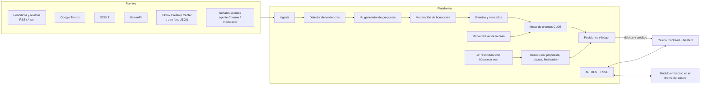
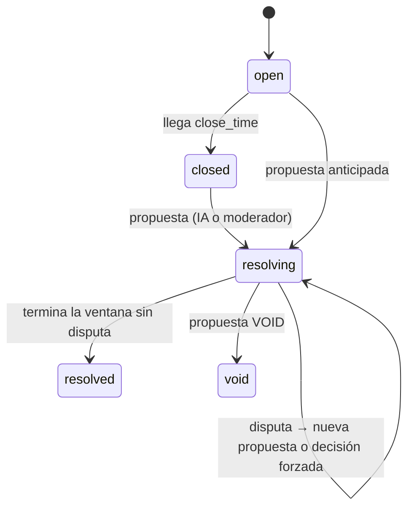

# Arquitectura

## Visión general

Un solo servicio Node.js (TypeScript + Fastify) con PostgreSQL. Los libros de órdenes viven en memoria y se reconstruyen desde la base al arrancar.

## Cómo se parece a Polymarket

| Concepto | Polymarket | Esta plataforma |
|---|---|---|
| Acciones | Tokens SÍ/NO que pagan 1 USDC si aciertan | Acciones SÍ/NO que pagan $1 si aciertan |
| Precio | 0,01–0,99 = probabilidad | 1–99 centavos = probabilidad en % |
| Libro | CLOB, un libro por mercado con SÍ y NO en espejo | CLOB unificado en "espacio Sí" (`server/src/engine/orderbook.ts`) |
| Cruces | Transferencia, *mint* (comprador Sí + comprador No) y *merge* (vendedor Sí + vendedor No) | Los mismos cuatro tipos |
| Eventos múltiples | *negRisk*: un mercado binario por opción | `events.kind = 'multi'`: un mercado Sí/No por opción y un solo ganador |
| Órdenes | Límite (GTC/GTD) y de mercado (FOK/FAK) | Límite GTC, FOK y FAK; mercado por monto o por acciones |
| Liquidez | Market makers externos con incentivos | Market maker de la casa siempre activo, con control de inventario y exposición máxima |
| Resolución | Oráculo optimista de UMA: propuesta con fianza, ventana de disputa y votación | Propuesta (IA o moderador) con evidencia, ventana de disputa y decisión de un administrador si hay disputa |
| Anulación | 50-50 | `VOID`: paga $0,50 por acción a Sí y a No |
| Custodia | Billetera propia del usuario (USDC en Polygon) | Billetera del casino (seamless); la plataforma no custodia dinero |
| APIs | Gamma (metadatos), CLOB (precios, libro, órdenes), Data (posiciones) | `/v1/events`, `/v1/markets/:id/book`, `/v1/orders`, `/v1/positions`… |

## Motor de órdenes

Todas las órdenes se expresan en "espacio Sí":

- **Lado comprador**: `BUY_YES` a p y `SELL_NO` a (100 − p)
- **Lado vendedor**: `SELL_YES` a p y `BUY_NO` a (100 − p)

El emparejamiento sigue prioridad precio-tiempo y se ejecuta al precio del maker. El tipo de cruce lo decide la pareja de órdenes:

| Taker \ Maker | SELL_YES | BUY_NO |
|---|---|---|
| **BUY_YES** | transfer_yes | mint (se crea un par con $1 de colateral) |
| **SELL_NO** | merge (se destruye un par y se libera $1) | transfer_no |

**Un solo escritor por mercado.** `withLock("m:<id>")` serializa las órdenes de cada mercado. Dentro del candado:

1. Se simula el cruce (`dryRun`).
2. Se debita al casino exactamente lo necesario.
3. Se persiste todo en una transacción.
4. Se aplica el cruce al libro en memoria.
5. Se acredita a los vendedores.

Si la transacción falla después del débito, se reembolsa con un `txId` determinista.

**Unidades exactas:** precio en centavos, cantidades en centésimas de acción y dinero en micro-dólares (enteros). Así no hay errores de redondeo en el motor; solo se redondea al centavo al hablar con el casino. Los débitos se redondean hacia arriba, los créditos hacia abajo, y la diferencia queda registrada en `fees`.

## Market maker de la casa

`server/src/services/marketmaker.ts`, cada `MM_REFRESH_EVERY_SEC`, con la matemática de `server/src/engine/quoting.ts` (detalle y resultados de simulación en [MARKET-MAKER.md](MARKET-MAKER.md)):

- **Precio justo (v2)**: aprende del flujo de los jugadores con la curva LMSR (cada acción Sí neta sube el log-odds en 1/b). Se combina en log-odds con las referencias externas nuevas. En eventos múltiples todas las opciones se mueven juntas y suman 100%.
- **Cotizaciones**: `MM_LEVELS` niveles a cada lado sobre la curva LMSR, con el medio spread de Avellaneda-Stoikov. Solo usa órdenes de compra (BUY_YES y BUY_NO), así no necesita inventario: cuando un jugador le compra, el cruce *mint* crea las acciones.
- **Tiempo al cierre**: la profundidad y el tamaño por nivel bajan con √(días al cierre / `MM_TAU_REF_DAYS`).
- **Límites**: pérdida en el peor escenario por evento (`MM_MAX_LOSS_USD`) y total (`MM_MAX_TOTAL_LOSS_USD`). Al superarlos, solo cotiza lo que reduce el riesgo. El botón de pánico (`POST /admin/mm/kill`) retira todo.
- **Simulador** (`npm run sim`): jugadores casuales, informados, hinchada y ballenas contra v1 y v2, con el mismo motor de órdenes.
- **Ingresos de la casa**: comisión de taker (`TAKER_FEE_BPS`), spread y redondeos. `GET /admin/exposure` y `GET /admin/mm/status` muestran el riesgo.
- `MM_STRATEGY=v1` vuelve a la versión anterior (media móvil, spread fijo, corrimiento simple por inventario).

## Información → preguntas

1. **Ingesta** (`server/src/ingest/`): cada `INGEST_EVERY_MIN` lee todas las fuentes activas (RSS/Atom, Google Trends, GDELT, NewsAPI, feeds JSON). Guarda los artículos sin duplicados, con palabras clave (entidades y términos) y categoría.
2. **Señales sociales**: `POST /admin/social-signals` recibe lo que encuentra el agente que navega Instagram y TikTok con un perfil propio, o lo que carga un moderador. Pesan más que una noticia en el puntaje.
3. **Tendencias**: agrupa lo publicado en las últimas 48 h por palabras clave compartidas. Exige 2 o más fuentes distintas, o una búsqueda en alza o señal social. El puntaje combina volumen, diversidad de fuentes, frescura, señales sociales y búsquedas.
4. **IA generadora** (`server/src/ai/questions.ts`): con Claude y salida estructurada propone hasta 3 preguntas por tendencia. Cada una trae opciones, probabilidades iniciales, fecha de cierre, criterios exactos y fuente oficial. Las instrucciones excluyen temas sensibles: muertes, violencia, menores, personas privadas y resultados manipulables. Además se validan reglas duras: horizonte entre 24 h y 18 meses, probabilidades que suman 1 y 2 a 8 opciones.
5. **Mínimo por categoría**: la tarea `rellenar-categorias` (cada `REFILL_EVERY_MIN`) calcula, para cada una de las 26 categorías, mercados abiertos + borradores pendientes. Si el total no llega a `MIN_OPEN_PER_CATEGORY` (25), la IA investiga con búsqueda web las noticias, estrenos, eventos programados y búsquedas populares de esa categoría, y propone las preguntas que faltan (hasta `MAX_NEW_PER_CATEGORY_RUN` por pasada). El catálogo semilla (`server/src/db/catalog/`) arranca con más de 650 preguntas.
6. **Moderación**: todo queda como borrador `pending`, salvo que se active `AUTO_APPROVE_AI_DRAFTS`. Un moderador lo aprueba (puede editarlo) o lo rechaza. Al aprobarse se crea el evento y el market maker empieza a cotizar.

## Resolución

- El **resolvedor con IA** (`server/src/ai/resolver.ts`) investiga con búsqueda web y decide con salida estructurada. Solo propone si su confianza es de 90% o más. La propuesta igual pasa por la ventana de disputa (`CHALLENGE_WINDOW_MINUTES`, 2 h por defecto).
- Al finalizar: $1 por acción ganadora (o $0,50 si se anula), acreditado a cada jugador en su casino, más el webhook `event.resolved`.

## Calibración, sesgo e integridad

`server/src/services/integrity.ts` (sección "Calibración y sesgo" del back-office) mide con los mercados ya resueltos:

- **Calibración y Brier**: el precio del Sí 1, 7 o 30 días antes del cierre frente al resultado. Se agrupa en tramos de 10 puntos y por categoría y volumen. El Brier de apertura se compara con el del precio previo al cierre para ver si los jugadores mejoran la estimación inicial.
- **Sesgos**: favorito-batacazo (desvío en precios < 20% y > 80%), proporción Sí/No de los binarios (redacción) y precisión de la apertura según su origen (IA, catálogo o moderador).
- **Integridad**: concentración del dinero (un jugador ≥ 50% o los 5 mayores ≥ 80%), sesgo de hinchada (dinero al Sí de un país frente a la proporción de jugadores de ese país; requiere `country` en la sesión), resultado de la casa según quién propuso la resolución, compras grandes del lado ganador poco antes del cierre y cuentas nuevas con apuestas grandes.
- **Referencias externas**: precio de Polymarket (API pública Gamma, `markets.external_ref = "polymarket:<slug>"`, cada 30 min) o precios cargados a mano (casas de apuestas, encuestas).
- **Mitigación**: `MAX_STAKE_PER_MARKET_USD` (1.000 por defecto) limita lo que un jugador puede tener comprometido en un mercado.

Con menos de 30 mercados resueltos el panel avisa que los números son orientativos.

## Modelo de datos

| Tabla | Para qué |
|---|---|
| `operators`, `players` | Casinos y sus jugadores; la casa es un jugador interno |
| `events`, `markets`, `categories` | Eventos (binarios o múltiples) y sus mercados Sí/No |
| `orders`, `trades`, `positions` | Órdenes, cruces y posiciones con costo y ganancia realizada |
| `ledger`, `fees` | Cada débito o crédito con el casino (idempotente) y los ingresos de la casa |
| `price_history` | Serie de precios para gráficas |
| `resolutions` | Propuestas, disputas y finalizaciones |
| `sources`, `articles`, `social_signals`, `trends`, `drafts` | Información, tendencias y preguntas en moderación |
| `webhook_outbox` | Webhooks con reintentos |

## Antes de producción

- **Regulación**: apuestas con dinero real requieren la licencia del operador en cada país (Coljuegos en Colombia; en Ecuador revisa el marco vigente). Lo más simple es operar bajo la licencia del casino que integra el módulo. Revisa también si los mercados de política están permitidos en cada jurisdicción.
- **Fuentes**: verifica cada URL semilla desde tu servidor y respeta los términos de cada sitio. Para TikTok e Instagram usa APIs oficiales o proveedores con licencia. El agente de navegador es un complemento de bajo volumen.
- **Escala**: un proceso maneja miles de órdenes por segundo por mercado. Para varias instancias, asigna cada mercado a una sola (por hash del id) o mueve el emparejamiento a un servicio dedicado. Ejecuta las tareas programadas en una sola instancia.
- **Seguridad**: cambia `ADMIN_API_KEY` y `SESSION_SECRET`, restringe `/admin` por red, y define `frame-ancestors` con los dominios de tus casinos.
- **Observabilidad**: alertas sobre créditos `failed` en `ledger`, webhooks no entregados y exposición del market maker.
- **Panel de administración**: la API de admin ya existe. El siguiente paso es una interfaz web de moderación y riesgo.
