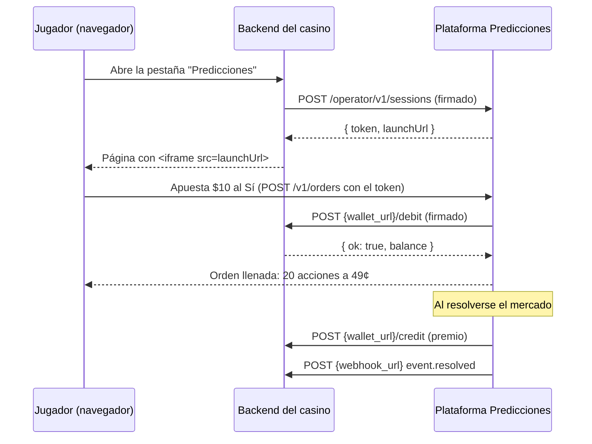

# Guía de integración para casinos

Esta guía explica cómo un casino online agrega **Predicciones** como una pestaña más de su sitio, sin URL nueva para el jugador y usando su propia billetera.

La integración tiene tres partes:

1. **Sesión y módulo embebido**: el backend del casino pide una sesión para el jugador y muestra el módulo en un iframe dentro de la pestaña "Predicciones".
2. **Billetera seamless**: la plataforma nunca guarda el dinero del jugador. Cuando apuesta, le pide al casino que debite; cuando vende o gana, le pide que acredite.
3. **Webhooks y reportes** (opcional): avisos de mercados resueltos y resúmenes financieros para conciliación.



## 1. Alta del casino

La plataforma crea el operador con `POST /admin/operators` y entrega tres credenciales:

| Credencial | Uso |
|---|---|
| `apiKey` (`pk_…`) | Identifica al casino cuando llama a la plataforma (`X-Operator-Key`) |
| `apiSecret` (`sk_…`) | Firma las llamadas del casino a la plataforma y verifica los webhooks |
| `walletSecret` (`ws_…`) | La plataforma firma con este secreto las llamadas a la billetera del casino |

El casino entrega:

- `walletUrl`: base de sus endpoints de billetera, por ejemplo `https://api.casino.com/predicciones/wallet`
- `webhookUrl` (opcional)
- `theme` (opcional): `{ "brandName": "Ecuabet", "primary": "#ffd400" }`. El módulo usa el nombre y el color del casino.
- `feeBps` (opcional): comisión por apuesta en puntos básicos (200 = 2%). Si no se indica, se usa la global.
  - A los jugadores que le ganan a la casa de forma sostenida se les suma un recargo de hasta 3% en lo que le compran al market maker de la casa (ver [MARKET-MAKER.md](MARKET-MAKER.md#protección-contra-el-apostador-informado)). Va incluido en el `fee` de cada orden y en el débito. Avísalo en los términos y condiciones del casino.

## 2. Firma de las peticiones (HMAC-SHA256)

Todas las llamadas servidor a servidor, en ambos sentidos, van firmadas igual:

```
mensaje   = timestamp + "\n" + MÉTODO + "\n" + ruta + "\n" + cuerpo
firma     = hex( HMAC_SHA256(secreto, mensaje) )
cabeceras = X-Timestamp: <milisegundos epoch>   X-Signature: <firma>
```

- `ruta` es el path con su query string, tal como se envía (por ejemplo `/operator/v1/sessions` o `/debit`).
- `cuerpo` es el JSON exacto que viaja (cadena vacía en un GET).
- Se rechazan timestamps con más de 5 minutos de diferencia.

Ejemplo en Node.js:

```js
import { createHmac } from "node:crypto";
const sign = (secret, ts, method, path, body) =>
  createHmac("sha256", secret).update(`${ts}\n${method}\n${path}\n${body}`).digest("hex");
```

Ejemplo en PHP:

```php
$firma = hash_hmac('sha256', $ts . "\n" . $metodo . "\n" . $ruta . "\n" . $cuerpo, $secreto);
```

## 3. Abrir la pestaña Predicciones

**`POST /operator/v1/sessions`**, firmado con `apiSecret` y con la cabecera `X-Operator-Key: <apiKey>`.

```json
{ "playerId": "123456", "displayName": "Santiago Rodas", "country": "EC" }
```

Respuesta:

```json
{
  "token": "eyJwaWQiOjEsIm9wIjoi....",
  "expiresAt": "2026-10-24T10:00:00.000Z",
  "launchUrl": "https://predicciones.tuplataforma.com/embed/?token=eyJwaWQi..."
}
```

En la pestaña "Predicciones" del casino:

```html
<iframe src="{launchUrl}" style="width:100%;height:100vh;border:0" title="Predicciones"></iframe>
```

- `playerId` es el ID del jugador en el casino. El jugador se crea en la plataforma la primera vez.
- `country` es opcional pero recomendado: código ISO de 2 letras del país del jugador (EC, CO, MX…). Sirve para medir el sesgo de "hinchada" en el back-office (por ejemplo, colombianos apostando por Colombia).
- `displayName` es opcional. En el feed público solo se muestra el nombre y la inicial del apellido ("Santiago R.").
- El token dura 4 horas (`SESSION_TTL_MIN`). Pide uno nuevo cada vez que el jugador abre la pestaña.
- **Front propio:** si el casino prefiere dibujar su propia interfaz, usa el mismo token como `Authorization: Bearer <token>` contra la API del jugador (sección 6).

## 4. Billetera seamless (lo que implementa el casino)

La plataforma llama por `POST` a cuatro endpoints bajo `walletUrl`. Van firmados con `walletSecret`, con las cabeceras `X-Operator-Id`, `X-Timestamp` y `X-Signature`. La ruta firmada es `/balance`, `/debit`, `/credit` o `/rollback`.

Los montos viajan como texto con 2 decimales, en la moneda del operador.

### `POST /balance`

```json
{ "playerId": "123456", "currency": "USD" }
```
→ `{ "ok": true, "balance": "250.00" }`

### `POST /debit`: el jugador apuesta

```json
{ "txId": "o_981_debit", "playerId": "123456", "amount": "10.00", "currency": "USD", "reason": "order", "marketId": 42, "orderId": 981 }
```
- Éxito: `{ "ok": true, "balance": "240.00", "operatorTxId": "CAS-778899" }`
- Sin saldo: `{ "ok": false, "error": "insufficient_funds" }`

### `POST /credit`: devoluciones, ventas y premios

```json
{ "txId": "pay_17_42_5", "playerId": "123456", "amount": "20.00", "currency": "USD", "reason": "payout", "marketId": 42 }
```
→ `{ "ok": true, "balance": "260.00", "operatorTxId": "CAS-778900" }`

Valores de `reason`:

| reason | Cuándo |
|---|---|
| `order` (débito) | El jugador compra acciones. Se debita lo que se llenó más la comisión, más lo que queda reservado en órdenes límite abiertas |
| `order_cancel_refund`, `order_market_closed_refund`, `order_resolution_refund` | Se devuelve lo reservado de una orden cancelada o de un mercado que cerró |
| `sell_proceeds` | El jugador vendió acciones antes del cierre |
| `payout` | Premio: $1 por acción ganadora |
| `void_refund` | Mercado anulado: $0,50 por acción, a Sí y a No |
| `resolution_bond` (débito) | Fianza de $10 del jugador al proponer o disputar un resultado ([ORACULO.md](ORACULO.md)) |
| `resolution_bond_refund`, `resolution_bond_reward` | Se devuelve la fianza; con premio si el jugador tenía razón en una disputa |

### `POST /rollback`

Se envía cuando un débito no tuvo respuesta clara (por ejemplo, un timeout):

```json
{ "txId": "r_o_981_debit", "originalTxId": "o_981_debit", "playerId": "123456", "amount": "10.00", "currency": "USD" }
```
Si el débito original se aplicó, el casino lo revierte. Si nunca llegó, responde `ok` sin hacer nada.

### Reglas obligatorias para el casino

- **Idempotencia por `txId`**: si llega un `txId` ya procesado, responde el mismo resultado sin volver a mover dinero. La plataforma reintenta los créditos fallidos con el mismo `txId` hasta que se confirmen.
- **Créditos siempre aceptados**: un crédito no debe rechazarse por límites de juego. Es dinero del jugador.
- Responde en menos de 8 segundos.

El casino de prueba en `server/mock-casino/server.ts` es una implementación de referencia completa, con verificación de firma, saldos e idempotencia.

## 5. Webhooks (opcional)

`POST {webhookUrl}`, firmado con `apiSecret`. La ruta firmada es el path del webhook.

```json
{ "id": 12, "type": "event.resolved", "createdAt": "…", "data": { "eventId": 7, "title": "¿Quién ganará Miss Universo 2027?", "outcome": "YES", "winningMarketId": 31 } }
```
Ante un error se reintenta con espera exponencial, hasta 10 veces.

## 6. API del jugador (con el token de sesión)

| Método | Ruta | Descripción |
|---|---|---|
| GET | `/v1/me` | Jugador, marca del casino y saldo (consulta `/balance`) |
| POST | `/v1/orders` | Apostar o vender (ver abajo) |
| DELETE | `/v1/orders/:id` | Cancelar una orden límite abierta |
| GET | `/v1/orders?status=open\|all` | Órdenes del jugador |
| GET | `/v1/positions` | Posiciones con precio actual, valor y ganancia o pérdida |
| GET | `/v1/me/activity` | Movimientos de dinero |
| POST | `/v1/resolutions/:id/dispute` | Disputar un resultado propuesto, con fianza: `{ reason, evidence? }` |
| POST | `/v1/events/:id/propose` | Proponer el resultado de un evento cerrado que nadie resolvió, con fianza: `{ outcome \| winningMarketId, explanation, evidence }` |

Cuerpo de `POST /v1/orders`:

```jsonc
// Apuesta simple (lo normal en un casino): compra de mercado por monto
{ "marketId": 42, "side": "BUY", "outcome": "YES", "type": "MARKET", "amount": 10 }
// Vender acciones antes del cierre
{ "marketId": 42, "side": "SELL", "outcome": "YES", "type": "MARKET", "shares": 20 }
// Orden límite (jugadores avanzados): queda en el libro hasta llenarse o cancelarse
{ "marketId": 42, "side": "BUY", "outcome": "NO", "type": "LIMIT", "price": 55, "shares": 50, "tif": "GTC" }
```

Respuesta:

```json
{ "orderId": 981, "status": "filled", "filledShares": 20, "avgPrice": 49, "spent": 10000000, "fee": 196000, "restingShares": 0, "fills": [{ "price": 49, "shares": 20 }] }
```

- `price` y `avgPrice` van en centavos del resultado elegido (49 = $0,49 = 49% de probabilidad).
- Los montos de la API (`spent`, `fee`, `balance`, `volume`) van en **micro-dólares** (1 USD = 1.000.000), como el USDC de Polymarket. Divide entre 1.000.000 para mostrarlos.
- `tif`: `GTC` queda en el libro, `FAK` llena lo que pueda y cancela el resto, `FOK` se llena completa o se rechaza. Las órdenes de mercado son `FAK`, con un límite de deslizamiento de 10 centavos sobre el mejor precio.
- `clientRef` (opcional) evita órdenes duplicadas si el casino reintenta.

## 7. Datos de mercado públicos (sin autenticación)

| Ruta | Descripción |
|---|---|
| `GET /v1/categories` | Categorías con número de mercados abiertos |
| `GET /v1/events?category=&sort=volume24h\|trending\|closing\|new&q=&limit=&spark=1` | Eventos con sus mercados, precio, cambio 24 h, volumen y jugadores |
| `GET /v1/events/:id` | Detalle, criterios de resolución y estado de resolución |
| `GET /v1/markets/:id/book` | Libro de órdenes, vista Sí y vista No |
| `GET /v1/markets/:id/prices-history?interval=1d\|1w\|1m\|all` | Serie de precios para gráficas |
| `GET /v1/markets/:id/trades` | Últimos cruces del mercado |
| `GET /v1/activity` | Feed de apuestas recientes, con nombres enmascarados |
| `GET /v1/stats` | Indicadores: volumen, jugadores en línea, movimientos, volumen por categoría y por hora |
| `GET /v1/trends` | Tendencias detectadas |
| `GET /v1/stream` | Tiempo real (Server-Sent Events): `trade`, `price`, `book`, `market` |
| `GET /v1/oracle/*` | Oráculo: probabilidades firmadas con Ed25519 e historial de calibración ([ORACULO.md](ORACULO.md)) |

## 8. Reportes para conciliación

| Ruta (firmada) | Descripción |
|---|---|
| `GET /operator/v1/reports/summary?from=&to=` | Débitos, premios, ventas, devoluciones, comisiones, créditos pendientes y gasto neto de jugadores |
| `GET /operator/v1/players/:playerId/ledger` | Todos los movimientos de un jugador, con `txId` y `operatorTxId` |
| `GET /operator/v1/players/:playerId/positions` | Posiciones de un jugador |

## 9. Errores

Formato: `{ "error": "codigo", "message": "texto legible en español" }`

| HTTP | Código | Significado |
|---|---|---|
| 400 | `invalid_request`, `invalid_price`, `invalid_amount`, `invalid_shares` | Datos inválidos |
| 401 | `unauthorized`, `bad_signature`, `stale_request`, `session_expired` | Autenticación |
| 402 | `insufficient_funds` | El casino rechazó el débito por saldo |
| 404 | `not_found` | No existe |
| 409 | `market_closed`, `no_liquidity`, `fok_not_filled`, `insufficient_shares`, `duplicate_order`, `stake_limit` | Estado del mercado o de la orden; `stake_limit` = el jugador superó el máximo comprometido por mercado |
| 502 | `wallet_error` | La billetera del casino falló |
